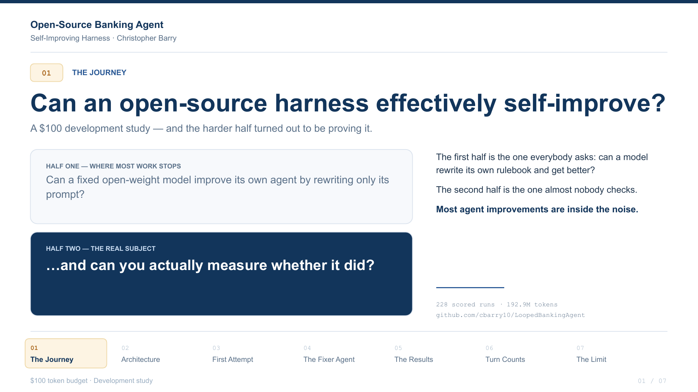
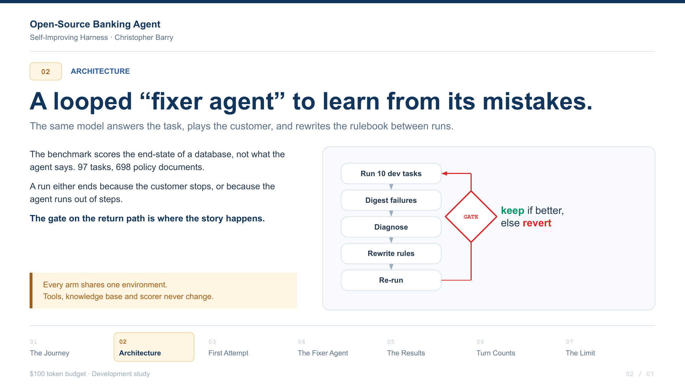
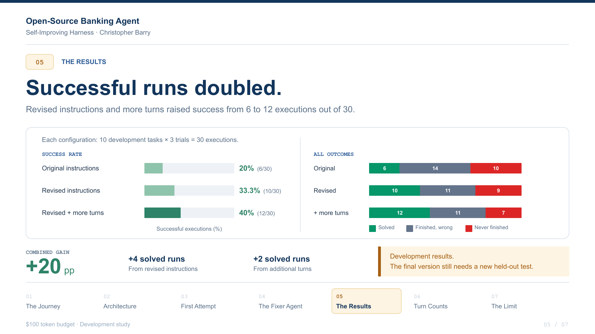
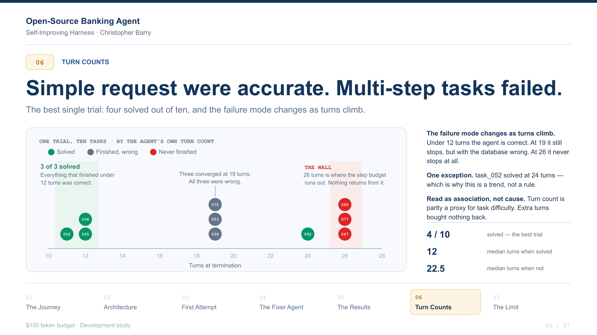

# LoopedBankingAgent

** Measuring whether a 27B open-weight model can improve accuracy on banking-specific tasks by re-writing harness rules .**

[](docs/OpenSourceBankingAgent-deck.pdf)

**[Full deck, 7 slides (PDF)](docs/OpenSourceBankingAgent-deck.pdf)**

τ²-bench `banking_knowledge`: 97 customer-service tasks over 698 policy documents,
scored on the end state of a database rather than on what the agent says.
Qwen3.8-27B plays all three roles, the agent, the simulated customer, and the
fixer that edits the agent's rulebook. No fine-tuning. The only thing that ever
changes is prompt text.

`248 scored runs · 205M tokens · ~$55 · every result committed by CI from the run that produced it`

## How it works

[](docs/OpenSourceBankingAgent-deck.pdf)

Every arm shares one environment. Tools, knowledge base and scorer never change.
The gate on the return path is where the story happens: a change is kept only if
the mean improves by at least 0.10 over three trials, which is one full task
equivalent and sits above the measured noise floor.

## Results

[](docs/OpenSourceBankingAgent-deck.pdf)

| Configuration | Mean | Solved | Never finished | Wrong but finished |
|---|---|---|---|---|
| No harness (control) | 0.200 | 6/30 | 10/30 | 14/30 |
| Model-authored harness | 0.333 | 10/30 | 9/30 | 11/30 |
| **Harness plus step budget** | **0.400** | **12/30** | 7/30 | 11/30 |

**+0.200 against control, clearing a pre-registered 0.10 margin twice over.** The
two components stack because they fix different failures: the harness turns wrong
answers into right ones, the step budget turns timeouts into answers.

A single-trial probe on ten untouched pre-registered tasks scored 0.200 against a
0.100 control. That sits below the three-trial bar everything else here is held
to, so transfer remains open.

## Three findings

**The scoreboard was noise.** The identical control, run three times, scored
2/10, 3/10, 1/10. I deleted a 3/10 I had already recorded as a win. Worse, my
keep-or-revert gate had been operating at its own error bar. Everything after
uses three trials and a 0.10 margin.

**The model was blind, not weak.** Its first two attempts failed because its
evidence contained no tool responses and its prompt implied a rule could only be
a constraint. Given the full call-and-response trace and a wider repertoire, the
same model found the ordering bug itself and fixed it on the first try.

**Procedures worked. Policies cost steps.**

| Iteration | What the model changed | Mean | Outcome |
|---|---|---|---|
| 1 | Tightened a search constraint | 0.100 | reverted |
| 2 | Added a strict action gate | 0.100 | reverted |
| 3 | **Wrote seven procedures from an empty file** | **0.333** | **kept** |
| 4 | Added an escalation gate above them | 0.233 | reverted |
| 5 | Added a workflow checklist above them | 0.200 | reverted |

Both layered restrictions pushed non-convergence *above* the no-harness baseline,
13/30 and 12/30 against 10/30. Deliberation costs turns, and the turn count is
where the agent breaks.

[](docs/OpenSourceBankingAgent-deck.pdf)

Everything that finished under 12 turns was correct. Three tasks converged at 19
turns and all three were wrong. At 26 turns the budget runs out and nothing comes
back. Median turns when solved was 12, against 22.5 when not.

## Cost

**$0.80 per solved task.** The step budget bought accuracy and destroyed prompt
caching: the discount fell from 54% to 3% and spend rose 71% on 20% *fewer*
tokens. Failures are the expensive ones, since a lost agent runs to the turn cap
while a competent one finishes in half that.

## What I do not claim

No absolute score appears anywhere in this repo. Every number is a delta against
a control I ran myself under identical conditions, which is the only claim the
setup supports. On the public leaderboard, retrieval strategy alone moves the
same model by 2.5x, a wider swing than most of the distance between models, so
cross-setup comparison would be meaningless.

The 0.400 is a tuning-set result on ten tasks. One model, one domain, one keeper
in five iterations.

## Where to look

| | |
|---|---|
| [`docs/OpenSourceBankingAgent-deck.pdf`](docs/OpenSourceBankingAgent-deck.pdf) | the full seven-slide deck |
| [`harness/rules_fixer.md`](harness/rules_fixer.md) | the harness the model wrote, from an empty file |
| [`harness/fixer.py`](harness/fixer.py) | the loop: digest, diagnose, rewrite, evaluate, keep or revert |
| [`harness/FIXER_SPEC.md`](harness/FIXER_SPEC.md) | design, the v1 to v2 defect table, disclosures |
| [`harness/fixer_v2_log.md`](harness/fixer_v2_log.md) | every iteration's diagnosis, diff and outcome |
| [`harness/FAILURE_ANALYSIS.md`](harness/FAILURE_ANALYSIS.md) | failures classified against trajectory evidence |
| [`docs/sample-transcripts.md`](docs/sample-transcripts.md) | ten full conversations from one trial |
| [`results/`](results/) | all 21 scored runs, committed by CI, never hand-edited |

## Reproduce

```bash
./scripts/setup_env.sh                         # clones tau2-bench at the pin

STEP_BUDGET=26 TRIALS=3 RULES=rules_fixer.md \
  AGENT=llm_agent_harness RUNNER=python \
  ./scripts/run_eval.sh task_002 task_025 task_036 task_039 task_052 \
                        task_053 task_067 task_075 task_077 task_090
```

Needs `OPENROUTER_API_KEY`. Controls are frozen in
[`configs/model.yaml`](configs/model.yaml): tau2-bench v1.0.1 at `fc0055dc`,
temperature 0, seed 42, BM25 `top_k` 10, `max_steps` 50. A human may author the
method; a human never authors the artifact under test.
